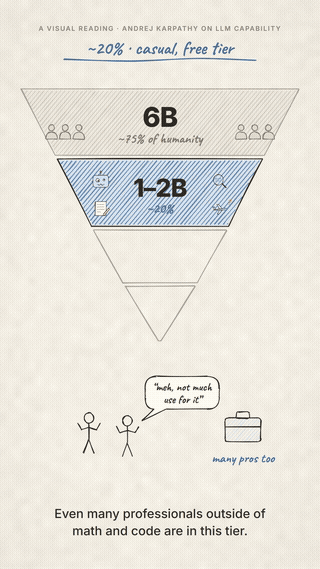
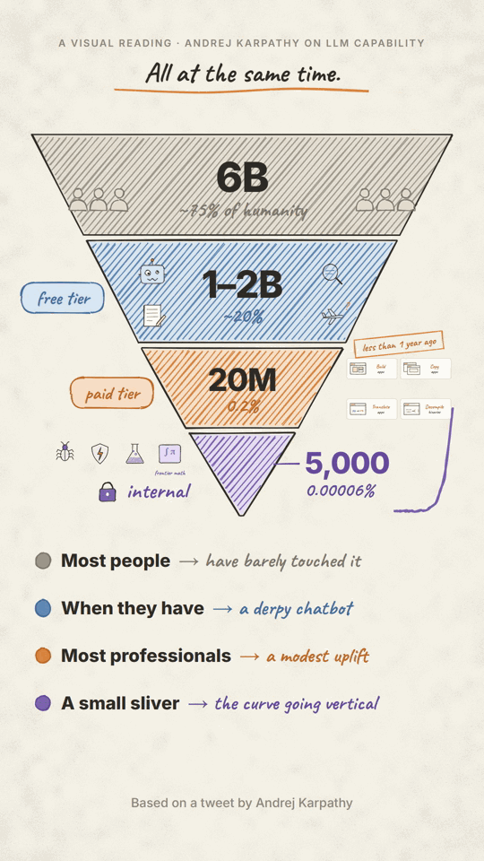

# explainer-video — a Claude Code skill

Turn a tweet, essay, thread or script into a **narrated, hand-drawn animated explainer video**: a diagram that builds itself, numbers that count up, icons that pop in on the exact spoken word, captions, a neural voiceover and a soft music bed. Output is an MP4, vertical 9:16 (Shorts / Reels / TikTok) or 16:9.

<p align="center">
  
  &nbsp;&nbsp;
  
</p>

## Install

In Claude Code:

```
/plugin marketplace add ARYANJATHAR/explainer-video-plugin
/plugin install explainer-video@aryan-skills
```

Then just ask, e.g.:

> Make a 2-minute vertical explainer video of this thread: …

> Turn my blog post on vector databases into a sketch-style YouTube Short with voiceover.

Claude picks up the skill automatically (or invoke it with `/explainer-video`).

**Manual install (no plugin system):** copy `skills/explainer-video/` into `~/.claude/skills/`.

## Requirements

| | |
|---|---|
| Python 3.10+ | `pip install edge-tts numpy pillow` |
| Node.js 18+ | npm packages are installed per project automatically |
| ffmpeg | on your `PATH` |
| Chrome / Edge / Chromium | auto-detected; or set `CHROME_PATH` |
| Internet | for the text-to-speech step |

## Privacy / data

- **Narration text is sent to Microsoft.** `tts.py` uses [edge-tts](https://github.com/rany2/edge-tts), which sends your script text to Microsoft's Edge online text-to-speech service to generate the voiceover. Don't put anything in a script you wouldn't want sent there.
- **Packages are downloaded from npm** when a project is scaffolded (`roughjs`, `@fontsource/caveat`, `@fontsource/inter`, `playwright-core`).
- **Nothing else leaves your machine.** Rendering, frame capture, music synthesis and encoding all run locally; output stays in your project folder. The skill collects no personal data and has no telemetry.

## How it works

1. **Narration** — the script is split into cues and voiced with [edge-tts](https://github.com/rany2/edge-tts). Word-level timestamps are saved to `timeline.json`.
2. **Choreography** — a small SVG animation engine (pencil-style shapes via [rough.js](https://roughjs.com)) where every element is keyed to narration time, e.g. `icon.pop(W('c7', 'chatbot'))` appears exactly as "chatbot" is spoken. Rendering is deterministic: `window.seek(t)` draws any frame.
3. **Render** — headless Chrome captures frames in parallel; ffmpeg encodes and mixes the voice with a synthesized, ducked ambient pad, loudness-normalized to −14 LUFS.

A complete worked example (a 3:41 video, the one in the preview above) ships in `skills/explainer-video/assets/examples/`.

### Using the pipeline by hand

```bash
python skills/explainer-video/scripts/new_project.py my-video            # or --example
cd my-video
# edit script.json (narration) and scene.js (animation)
python tts.py                 # voice + timeline
node render.js sheet 3 20 45  # quick contact sheet of stills -> build/sheet.png
python mix.py                 # music bed
node render.js video 6        # render frames (parallel)
node render.js final ../my-video.mp4
```

## Notes

- `edge-tts` uses Microsoft Edge's online read-aloud service, which is not an official public API. It may change, and you should check that your use (especially commercial) is allowed.
- The bundled example narrates a public post by Andrej Karpathy with attribution, to demonstrate the format. It isn't affiliated with or endorsed by him.
- Fonts (Caveat, Inter; SIL OFL) and rough.js (MIT) are installed from npm at project setup, not redistributed here.

## License

MIT
